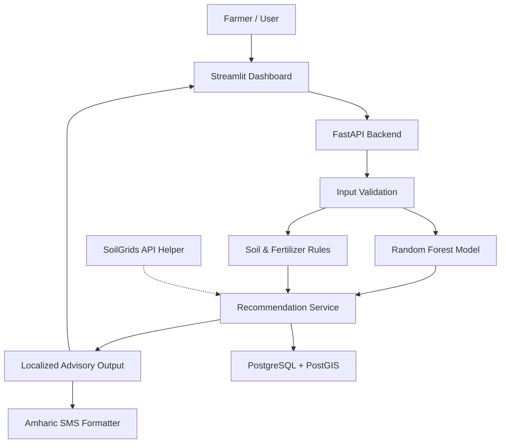

# 🌱 EthioSoil-AI

### AI-Powered Soil Analysis, Crop Recommendation & Fertilizer Advisory System for Ethiopian Agriculture

EthioSoil-AI is an agricultural decision-support project designed to help farmers make more informed farming decisions using soil characteristics, farm information, and machine learning.

The system analyzes soil nutrient levels and environmental conditions to recommend suitable crops, assess soil acidity, and provide fertilizer guidance. It combines a machine learning model with agronomic recommendation rules and a simple dashboard to make agricultural insights more accessible.

🏆 **Achievement:** 3rd Place — Agricultural AI Collaborative Challenge

---

## 🌾 Project Overview

Agricultural productivity is strongly influenced by soil health, nutrient availability, and environmental conditions. However, farmers may not always have access to accessible, data-driven guidance about which crops to cultivate or how to manage soil nutrients.

EthioSoil-AI aims to address this challenge through a digital advisory system that processes farm and soil information and generates localized recommendations.

Users can provide information such as:

- Farm location and Kebele name
- Farm size in hectares
- GPS coordinates
- Soil pH
- Nitrogen (N)
- Phosphorus (P)
- Potassium (K)
- Expected seasonal rainfall

Based on the submitted information, the system generates crop recommendations and soil-management guidance.

---

## ✨ Key Features

### 🌱 Machine Learning-Based Crop Recommendation

- Uses a Random Forest classification model to predict suitable crops.
- Processes soil nutrient values and environmental features.
- Returns a predicted crop and its prediction confidence.

### 🧪 Soil Acidity Assessment

- Evaluates soil pH.
- Identifies strongly acidic soil conditions.
- Provides guidance on agricultural lime or wood ash application.

### 💊 Fertilizer Recommendation

Provides two types of fertilizer guidance:

- **Chemical fertilizer:** Calculates recommendation quantities for Urea and DAP based on the submitted nitrogen and phosphorus values.
- **Organic fertilizer:** Provides an organic soil-improvement recipe using decomposed farmyard manure and local wood ash.

### 🌍 Multilingual Recommendations

The recommendation service supports three languages:

- English
- Amharic
- Afaan Oromo

This is intended to make agricultural guidance more accessible to local users.

### 📍 Location-Aware Soil Information

- Accepts farm GPS coordinates.
- Includes a SoilGrids API helper for retrieving soil pH and organic carbon information.
- Supports recording farm locations using spatial database fields.

### 📱 Farmer-Friendly Advisory Messages

Includes an Amharic SMS message formatter that converts recommendation information into concise messages suitable for feature-phone users.

### 📊 Advisory Dashboard

A Streamlit interface allows users to submit farm information and view:

- Recommended crop
- Prediction confidence
- Soil acidity status
- Chemical fertilizer recommendation
- Organic fertilizer recommendation
- Model performance indicators

### 🗄️ Advisory Data Storage

Uses PostgreSQL and PostGIS to store farm information, soil measurements, location geometry, crop recommendations, and advisory records.

---

## 🏗️ System Architecture

The application follows a frontend-backend architecture.



### Recommendation Workflow

1. The user enters farm and soil information through the Streamlit dashboard.
2. The dashboard sends the information to the FastAPI recommendation endpoint.
3. The backend validates the submitted data using Pydantic schemas.
4. The recommendation service processes the soil and environmental features.
5. The Random Forest model predicts a suitable crop.
6. Rule-based logic generates soil acidity and fertilizer guidance.
7. The results are localized according to the selected language.
8. The advisory record is stored in PostgreSQL.

---

## 🧠 Machine Learning Approach

The crop recommendation component uses a **Random Forest Classifier**.

### Input Features

The training script uses the following features:

| Feature | Description |
|---|---|
| N | Nitrogen level |
| P | Phosphorus level |
| K | Potassium level |
| Temperature | Environmental temperature |
| Humidity | Environmental humidity |
| pH | Soil acidity/alkalinity |
| Rainfall | Rainfall amount |

### Model Training

The training pipeline:

1. Loads the crop recommendation dataset.
2. Separates input features and target crop labels.
3. Splits the data into training and testing sets.
4. Trains a Random Forest Classifier with 100 estimators.
5. Evaluates the model on the test set.
6. Saves the trained model using Joblib.

The trained model is saved at:

```text
models/crop_model.pkl
```

---

## 🛠️ Technology Stack

| Component | Technologies |
|---|---|
| Programming Language | Python |
| Machine Learning | Scikit-learn, Random Forest |
| Model Persistence | Joblib |
| Backend API | FastAPI |
| Data Validation | Pydantic |
| Frontend Dashboard | Streamlit |
| Database | PostgreSQL |
| Spatial Database | PostGIS, GeoAlchemy2 |
| Data Processing | NumPy, Pandas |
| External Soil Data | ISRIC SoilGrids API |
| HTTP Requests | Requests |

---

## 📂 Project Structure

```text
Ethio-soil/
│
├── models/
│   └── crop_model.pkl
│
├── app.py              # Streamlit dashboard
├── main.py             # FastAPI application and API endpoints
├── services.py         # Crop prediction and advisory service
├── train.py            # Machine learning model training
├── rules.py            # Soil and fertilizer recommendation rules
├── schemas.py          # Pydantic input and output schemas
├── models_db.py        # PostgreSQL/PostGIS database models
├── soil_service.py     # SoilGrids API integration helper
├── sms_service.py      # Amharic SMS message formatting
├── view_logs.py        # Advisory log utilities
│
└── requirements.txt    # Python dependencies
```

---

## 🚀 Getting Started

### 1. Clone the Repository

```bash
git clone https://github.com/betsinat-amare/Ethio-soil.git
cd Ethio-soil
```

### 2. Create a Virtual Environment

```bash
python -m venv venv
```

Activate it:

**Linux / macOS**

```bash
source venv/bin/activate
```

**Windows**

```bash
venv\Scripts\activate
```

### 3. Install Dependencies

```bash
pip install -r requirements.txt
```

The database modules also require:

```bash
pip install sqlalchemy geoalchemy2 psycopg2-binary
```

### 4. Configure PostgreSQL and PostGIS

Create a PostgreSQL database named:

```sql
CREATE DATABASE ethiosoil_db;
```

Connect to the database and enable PostGIS:

```sql
CREATE EXTENSION postgis;
```

Update the database connection URL in `models_db.py` to match your PostgreSQL username, password, host, and database configuration.

### 5. Train the Machine Learning Model

```bash
python train.py
```

This trains the Random Forest classifier and saves the model under the `models/` directory.

### 6. Start the FastAPI Backend

```bash
uvicorn main:app --reload
```

The API will be available at:

```text
http://127.0.0.1:8000
```

Interactive API documentation:

```text
http://127.0.0.1:8000/docs
```

### 7. Start the Streamlit Dashboard

Open another terminal, activate the virtual environment, and run:

```bash
streamlit run app.py
```

The dashboard will normally be available at:

```text
http://localhost:8501
```

---

## 🔌 API Endpoint

### Generate Crop and Soil Recommendations

**Endpoint**

```http
POST /api/v1/recommend
```

**Example Request**

```json
{
  "kebele_name": "Ginchi",
  "farm_size_hectares": 1.5,
  "latitude": 9.0,
  "longitude": 38.5,
  "soil_ph": 4.8,
  "nitrogen_n": 35,
  "phosphorus_p": 12,
  "potassium_k": 110,
  "rainfall": 1150,
  "language": "en"
}
```

**Supported language values:** `en`, `am`, `om`.

The API returns a structured recommendation response containing the predicted crop, confidence, soil acidity assessment, and fertilizer guidance.

---

## 🏆 Recognition

**3rd Place — Agricultural AI Collaborative Challenge**

EthioSoil-AI was developed as a collaborative agricultural AI project addressing practical farming challenges through data-driven crop and soil recommendations.

---

## 🔮 Future Improvements

Potential areas for further development include:

- Integrating live soil data retrieval directly into the recommendation workflow.
- Improving crop recommendations using more representative Ethiopian agricultural datasets.
- Refining fertilizer quantity calculations using locally validated agronomic recommendations.
- Integrating an SMS gateway for direct delivery of farmer advisories.
- Expanding language support and improving localization.
- Adding interactive farm maps and richer spatial analysis.
- Improving model evaluation and recommendation explainability.

---

## ⚠️ Project Notes

This repository represents a collaborative project and an evolving implementation. Recommendations are generated using the current model and rule-based logic and should be validated against local soil tests and qualified agronomic guidance before being used for actual farm applications.

The SMS module currently formats advisory messages; it does not itself provide an external SMS delivery gateway.

---

## 👥 Contributors

Developed collaboratively as part of the Agricultural AI Collaborative Challenge.

